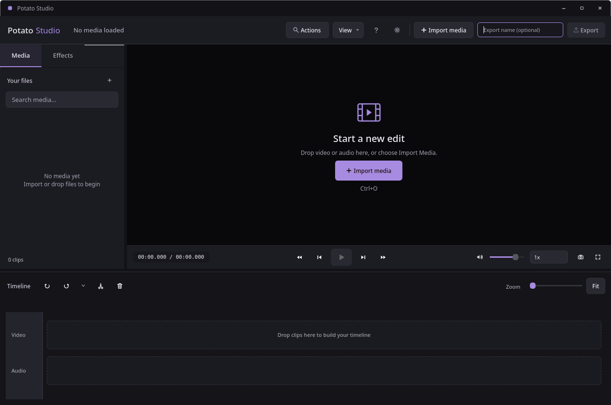
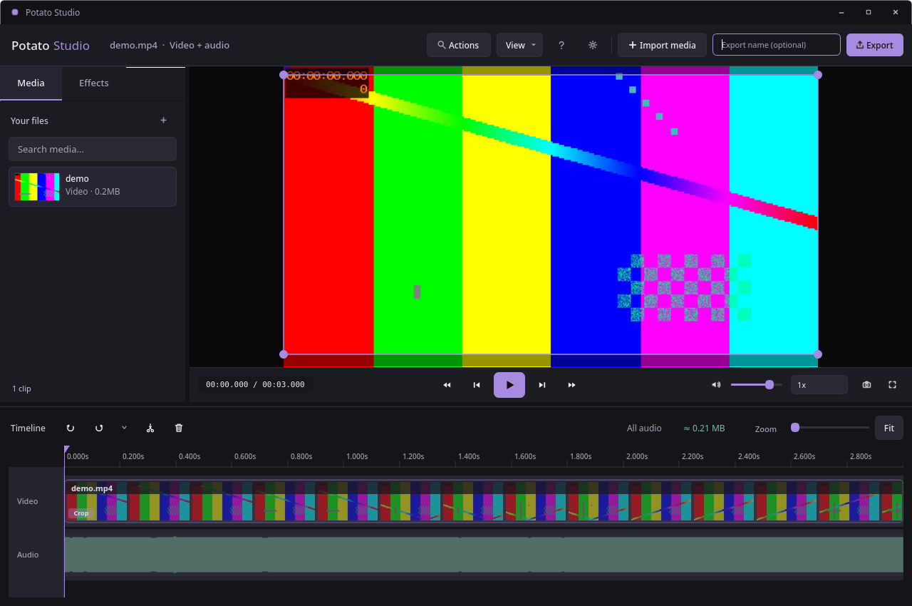

# Responsiveness and interface polish

The timeline now retains exact waveform peaks for visible screen columns instead of rescanning the 100 Hz envelope on every repaint. Cache storage is bounded by viewport width (about 6 KB at 1600 pixels), independent of recording length and zoom. Gain, selection, trim and mute changes reuse source peaks. Width, zoom, scroll, duration, sample count and asynchronous waveform replacements invalidate them. Waveform lines are submitted in one batch per clip.

## Measurements

Release build, Qt 6.11.2, offscreen, 1600 × 240 timeline; deterministic 100 Hz waveform, 120 full redraws. Search budget: two implementation variants, no external services or spending. Baseline and both performance variants were checked against saved PNGs: pixel-identical before the deliberate visual refinements. The correctness gate also compares cached rendering with fresh rendering after viewport and edit changes and checks exact peaks against a direct scan.

| Variant | Two-hour source | 24-hour source | Result |
| --- | ---: | ---: | --- |
| Baseline | 261.405 ms | 1593.640 ms | Reference |
| Cache screen-column peaks | 140.842 ms | 308.627 ms | Correct; retained |
| Cache plus batched lines | 131.923 ms | 240.603 ms | Pixel-identical; retained |
| Cache plus batched lines, repeat | 125.844 ms | 247.285 ms | Correct |
| Final interface, concurrent playback and test load | 152.325 ms | 317.643 ms | Correct |
| Final interface, standalone repeat | 130.177 ms | 255.085 ms | Correct; final default |

The final standalone run is about 2.0× faster for the two-hour fixture and 6.2× faster for the 24-hour fixture. These numbers describe repeated full timeline rendering, not media import, encoding, decoding, first-paint latency, or end-to-end application speed. A new viewport still computes its peaks once. Desktop load introduces timing noise; there was one original baseline measurement and repeated candidate measurements.

A separate real-desktop check played a local H.264 3840 × 2160, 60 fps recording with CUDA decoding configured. Over four seconds the UI heartbeat measured p95 23 ms and worst 69 ms (257 samples), passing the existing p95 <25 ms / worst <100 ms gate. This is a final-state responsiveness check, not a before/after decoding benchmark.

```sh
cmake --build cmake-build-release --parallel 4
QT_QPA_PLATFORM=offscreen POTATO_EDITOR_BENCHMARK=1 ./cmake-build-release/EditorTests benchmarkWaveformRendering -nocrashhandler
QT_QPA_PLATFORM=offscreen ./cmake-build-release/EditorTests waveformCacheSurvivesViewportAndEditChanges playbackRepaintsOnlyMovingPlayhead -nocrashhandler
ctest --test-dir cmake-build-release --output-on-failure
QT_QPA_PLATFORM=xcb QT_FFMPEG_DECODING_HW_DEVICE_TYPES=cuda POTATO_EDITOR_PROFILE_MEDIA=/path/to/4k-recording.mp4 ./cmake-build-release/EditorTests profileInteractivePlayback -nocrashhandler
```

The final regression suite passed: 38 cases, zero failures, two opt-in profiling/benchmark cases skipped. The opt-in rendering benchmark and desktop playback profile were run separately and passed. The empty and loaded compact layouts also passed under the real XCB platform.

## Interface review

Full review within the changed editor workspace, Qt Widgets, existing configurable palette and QSS; custom timeline uses QPainter. Scope: empty workspace, media/effects tabs, transport, timeline, focus and disabled states. Export and settings dialogs were not visually redesigned. Palette customization remains intact.

Design direction: keep the existing studio palette (canvas #121217, surface #1B1B22, control #292932, text #EDECF2, violet #A78BE0, audio #83BBA6), Noto Sans UI typography and fixed-width timecode. Use a quiet viewer, distinct transport surface, recognizable filmstrips, and restrained track geometry. Selected clips and tabs carry the accent. Avoid extra decorative panels and motion in frequent editing interactions.

| Category | Evidence | Result |
| --- | --- | --- |
| Typography | Main window timecode QSS, empty/loaded/compact screenshots | Existing type scale retained; timecode given a stable backing surface |
| Surfaces | Main window QSS and timeline paint code | Clearer transport, tabs, empty tracks and audio clip bounds |
| Animations | Changed controls and timeline | No new animations; immediate feedback retained |
| Icons | Existing vector icons, toolbar controls, selected trim handles | Consistent icon set retained; larger toolbar targets and visible trim handles |
| Performance | Benchmark, exact peak checks, cached/fresh image comparisons, 4K heartbeat | Passed within measured scope |

| Severity | Location | Before | After | Why |
| --- | --- | --- | --- | --- |
| High | src/Main/mainWindow.cpp, setupUi/setupWorkspace | Native video widget could cover the empty prompt | Hide native surface and initialize playback visibility | Empty state provides a visible import action |
| Medium | src/Main/timelinewidget.cpp, waveformPeakAtColumn/paintEvent; audio.cpp; mediaLoader.cpp | Repeated sample scans and individual line calls | Viewport peak cache, explicit source invalidation, batched lines | Removes repeated work from interactive repaints |
| Low | src/Main/mainWindow.cpp, toolbar/sidebar setup | 32 px help, settings and sidebar import targets | 36 px targets | Easier pointer targeting without breaking compact layout |
| Low | src/Main/mainWindow.cpp, buildAppStyleSheet | Transport blends into canvas; timecode floats over it | Raised transport surface with separator and inset timecode | Clear transport hierarchy and stable numeric display |
| Medium | src/Main/mainWindow.cpp, buildAppStyleSheet | Icon and primary button focus rules can be obscured by more specific styles | Explicit focus borders; disabled icons have no focus border | Keyboard state remains visible |
| Low | src/Main/mainWindow.cpp, LibraryTabs QSS | Active state relies on violet text and underline | Text plus tinted active background and underline | Stronger static selection cue |
| Low | src/Main/timelinewidget.cpp, empty tracks | Solid rectangular empty blocks | Rounded, subdued fill and dashed bounds | Tracks read as drop destinations |
| Low | src/Main/timelinewidget.cpp, filmstrip drawing | Thumbnails too dim to identify content | Increased thumbnail opacity | Recognizable clips while labels remain legible |
| Medium | src/Main/timelinewidget.cpp, selected clip drawing | Trim edges lack persistent affordances | Small rounded selected trim handles | Makes trimming discoverable |
| Low | src/Main/timelinewidget.cpp, audio drawing | Waveform floats in a full-width band | Faint per-clip audio fill and outline | Connects audio ranges to their clip boundaries |

Considered and rejected: adding hover/entrance animations would add repeated motion to frequent editing actions; a new palette would unnecessarily replace user preferences; increasing every transport control to 40 px would crowd the existing compact desktop layout. The original typography and vector icon set already provide a coherent foundation.

Verification: built successfully; regression suite, opt-in rendering benchmark, viewport/edits image comparison, incremental/full repaint comparison, XCB compact/loaded layout, and real 4K playback check passed. No animation replay is needed because no animation was added. Hover/focus/disabled rules were inspected in source; a complete manual keyboard and hover walkthrough, Wayland, Windows, macOS, and all dialog surfaces were not verified. Verdict: approve the checked workspace changes, with these platform and manual interaction checks remaining unverified.




